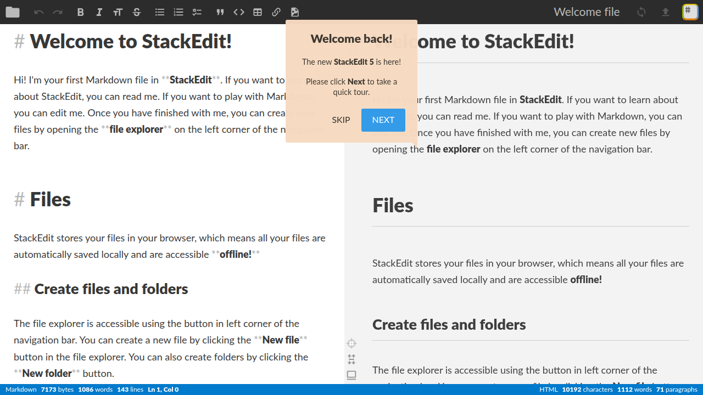

# StackEdit — Markdown-редактор в браузере (русская сборка)

Форк [benweet/stackedit](https://github.com/benweet/stackedit) v5.15.4 (Apache-2.0): Markdown-редактор
с живым предпросмотром, который работает целиком в браузере — без аккаунта и без сервера. Здесь он
собирается в 2026 году, ставится как обычное приложение (PWA) и снабжён русской документацией.

**Готовый адрес:** <https://dnikulshin.ru/stackedit/>



## Что это

StackEdit — редактор Markdown в браузере: текст слева, отрендеренный результат справа, прокрутка
синхронизирована. Файлы и папки лежат локально, в IndexedDB этого браузера, поэтому работа не зависит
от сети: после первой загрузки приложение открывается офлайн. Отдельного приложения в Google Play у
StackEdit нет и никогда не было — «установка» здесь это установка сайта как PWA: Chrome/Edge/Safari
ставят его как обычную программу, магазин для этого не нужен.

Приложение умеет: таблицы, списки задач, сноски, формулы (KaTeX), диаграммы (Mermaid), нотные записи
(ABC), подсветку кода, экспорт в Markdown/HTML по шаблонам Handlebars, несколько рабочих пространств,
бэкап всех данных одним файлом, публикацию и синхронизацию с GitHub/GitLab/Gist/Google Drive/Dropbox/
WordPress/Blogger/Zendesk/CouchDB (последние три требуют своих OAuth-ключей, см.
[docs/ru/self-host.md](docs/ru/self-host.md)).

Не умеет (ограничения апстрима): экспорт в PDF и через Pandoc — обработчик на сервере требует платного
бэкенда stackedit.io; облачной синхронизации «из коробки» без своих ключей нет; между устройствами
ничего не переносится само.

## Как начать

**1. Ничего не ставить** — открыть <https://dnikulshin.ru/stackedit/> и установить как приложение:
Android/Chrome → меню → «Установить приложение»; iOS/Safari → «Поделиться» → «На экран „Домой“».

**2. Раздать локально без сборки** — взять готовый архив из
[релиза](https://github.com/DNikulshin/stackedit/releases/latest) и запустить скрипт из него:

```bash
curl -fL -o stackedit-pwa.tar.gz \
  https://github.com/DNikulshin/stackedit/releases/latest/download/stackedit-pwa-5.15.4.tar.gz
tar xzf stackedit-pwa.tar.gz && cd stackedit-pwa && ./start.sh   # → http://localhost:8080/
```

В Windows — распаковать `.zip` и запустить `start-windows.cmd` (нужен Python 3). Подробно —
[docs/ru/quickstart.md](docs/ru/quickstart.md).

**3. Собрать самому** — нужен Linux/macOS (или WSL) и ~2.5 ГБ на диске:

```bash
git clone https://github.com/DNikulshin/stackedit.git
cd stackedit
./scripts/build-local.sh          # сам скачает изолированный Node 14 в .toolchain/
.toolchain/node-v14.21.3-linux-x64/bin/node .   # → http://localhost:8080/app
```

Детали, требования и все известные засады — [docs/ru/build.md](docs/ru/build.md).

## Как пользоваться

Подробное руководство: **[docs/ru/guide.md](docs/ru/guide.md)** — интерфейс, файлы и корзина, что и
куда сохраняется, шорткаты, экспорт, синхронизация и History, настройки, вкладка Storage, бэкап,
офлайн и установка.

Коротко о данных: сохранять вручную не нужно — изменения пишутся в IndexedDB раз в секунду, но база
привязана к браузеру и адресу сайта. Перенос на другое устройство — через **Workspace backups →
Export all workspaces backup** (восстанавливается всё, включая позицию курсора) или через Git-провайдера.

## Документация

| Документ | О чём |
| --- | --- |
| [docs/ru/guide.md](docs/ru/guide.md) | **как пользоваться**: интерфейс, файлы, шорткаты, экспорт, синхронизация, бэкап |
| [docs/ru/quickstart.md](docs/ru/quickstart.md) | готовое приложение на ПК и телефон без сборки и зависимостей |
| [docs/ru/build.md](docs/ru/build.md) | сборка из исходников: требования, засады, проверка результата |
| [docs/ru/pc.md](docs/ru/pc.md) | установка на ПК: локальный сервер, автозапуск, офлайн |
| [docs/ru/phone.md](docs/ru/phone.md) | телефон без магазина: PWA в Android/iOS, HTTPS |
| [docs/ru/self-host.md](docs/ru/self-host.md) | свой сервер: VPS + Caddy + systemd, OAuth-ключи, Docker |
| [docs/ru/faq.md](docs/ru/faq.md) | ошибки сборки и запуска и что с ними делать |
| [docs/ru/chrome-as-server.md](docs/ru/chrome-as-server.md) | браузер как сервер и локальная СУБД: что реально работает в 2026 |
| [README.ru.md](README.ru.md) | то же, что здесь, плюс таблица «что работает / что нет» и список изменений кода |

## Что изменено относительно апстрима

Скрипты сборки и раздачи (`build-local.sh`, `prepare-static.sh`, `check-static.sh`, `deploy-pages.sh`),
CI с проверкой установки PWA, `docker/Dockerfile`, русская документация — и несколько правок самого
приложения: бэкап всех workspace с восстановлением позиции курсора, постоянное хранение и вкладка
**Storage**, `sync()` пишет только изменившееся (2 мс вместо 12–15 мс каждую секунду), исправлено
падение настроек на пустом профиле. Подробно, с файлами и коммитами — [README.ru.md](README.ru.md),
раздел «Что изменено относительно апстрима».

Оригинальный английский README апстрима сохранён в [README.upstream.md](README.upstream.md).

## Лицензия

Apache-2.0, как у апстрима. См. [LICENSE](LICENSE).
