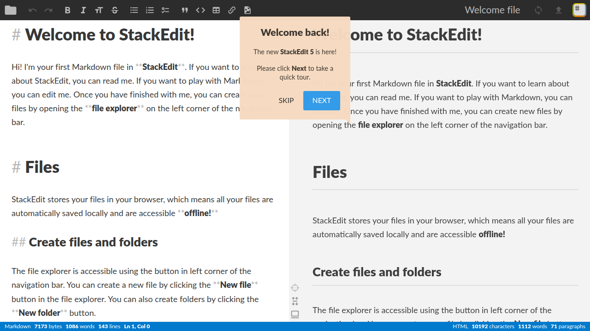

# StackEdit — сборка из исходников и установка (документация на русском)

Короткий обзор проекта, быстрый старт и ссылки — в [README.md](README.md).
Руководство по самому редактору (интерфейс, файлы, шорткаты, экспорт, синхронизация, бэкап) —
[docs/ru/guide.md](docs/ru/guide.md). Здесь — сборка, установка и ограничения собственной сборки.

Этот репозиторий — форк [benweet/stackedit](https://github.com/benweet/stackedit) (v5.15.4, Apache-2.0)
с исправлениями, необходимыми для сборки в 2026 году, скриптом сборки, небольшими правками самого
приложения (бэкап и постоянное хранение, скорость записи в IndexedDB) и русской документацией.

Если коротко: StackEdit — это веб-редактор Markdown (PWA). Отдельного приложения в Google Play у него
**нет и никогда не было**, поэтому «установка из магазина» — не тот путь. Рабочий способ — собрать его
самому (или взять свой сервер) и поставить как PWA: Chrome/Edge/Safari ставят такой сайт как обычное
приложение, магазин для этого не нужен.



## Что внутри

| Документ | О чём |
| --- | --- |
| [docs/ru/guide.md](docs/ru/guide.md) | **Как пользоваться редактором**: интерфейс, файлы, шорткаты, экспорт, синхронизация, бэкап |
| [docs/ru/quickstart.md](docs/ru/quickstart.md) | **Готовое приложение на ПК и телефон без сборки и зависимостей** |
| [docs/ru/build.md](docs/ru/build.md) | Сборка из исходников: требования, все известные засады, проверка результата |
| [docs/ru/pc.md](docs/ru/pc.md) | Установка на ПК: локальный сервер, автозапуск, установка как приложение, офлайн |
| [docs/ru/phone.md](docs/ru/phone.md) | Телефон без магазина: PWA в Android/iOS, варианты с HTTPS, что не работает |
| [docs/ru/self-host.md](docs/ru/self-host.md) | Свой сервер: VPS + Caddy + systemd, GitHub OAuth, статический хостинг, Docker |
| [docs/ru/faq.md](docs/ru/faq.md) | Ошибки сборки и запуска и что с ними делать |
| [docs/ru/chrome-as-server.md](docs/ru/chrome-as-server.md) | Браузер как сервер и локальная СУБД: что реально работает в 2026 и что из этого применимо здесь |

## Быстрый старт

**Совсем ничего не нужно** — готовая сборка опубликована по HTTPS, ставится как приложение из браузера:

### <https://dnikulshin.ru/stackedit/>

ПК/Android: Chrome → «Установить приложение»; iOS: Safari → «Поделиться» → «На экран „Домой“».

**Свой локальный сервер, без сборки и без зависимостей** (ни Node, ни npm, ни компиляторов):

```bash
# 1) готовые файлы из релиза
curl -fL -o stackedit-pwa.tar.gz \
  https://github.com/DNikulshin/stackedit/releases/latest/download/stackedit-pwa-5.15.4.tar.gz
tar xzf stackedit-pwa.tar.gz

# 2) раздать локально и открыть в браузере
cd stackedit-pwa && python3 -m http.server 8080
# → http://localhost:8080/app/  → Chrome: «Установить приложение»
```

Windows: возьмите **zip**-архив из того же релиза, распакуйте («Извлечь всё») и запустите
`start-windows.cmd` двойным кликом (нужен Python 3) — скрипт сам найдёт папку, поднимет сервер
и откроет браузер. **Не открывайте `app\index.html` двойным кликом** — по `file://` браузер не читает
манифест и Service Worker, и Chrome пишет «Файл манифеста отсутствует или недоступен для чтения».
Корень раздачи — папка, где лежат `app\`, `sw.js` и `manifest….json`; адрес — `http://localhost:8080/`.

Или вообще одной командой, если есть Docker:

```bash
docker run -d --name stackedit -p 8080:8080 ghcr.io/dnikulshin/stackedit:latest
# → http://localhost:8080/app
```

Подробно — [docs/ru/quickstart.md](docs/ru/quickstart.md) (ПК и телефон, без сборки).

Сомневаетесь, установится ли сборка: `node scripts/check-installability.mjs dist-static` — тот же
набор проверок, что в DevTools → Application → Manifest. Если Chrome писал «Файл манифеста
отсутствует или недоступен для чтения» — это ошибка страницы `chrome://extensions`
(каталог грузили как расширение), а не установки приложения.

## Сборка из исходников

```bash
git clone https://github.com/DNikulshin/stackedit.git
cd stackedit
./scripts/build-local.sh          # скачает изолированный Node 14 в .toolchain/ и соберёт dist/

# запуск именно этим Node (системный не подойдёт)
.toolchain/node-v14.21.3-linux-x64/bin/node .   # http://localhost:8080/app
```

Дальше: установить как приложение (см. [docs/ru/pc.md](docs/ru/pc.md)) или поднять на сервере
и поставить на телефон (см. [docs/ru/phone.md](docs/ru/phone.md)).

## Что работает в самостоятельной сборке, а что нет

Проверено на локальной сборке (Linux x64, Node 14.21.3, `dist/` отдан через `node .`):

| Возможность | Состояние |
| --- | --- |
| Редактор + живой предпросмотр, подсветка Markdown | ✅ работает |
| Локальные файлы и папки (IndexedDB в браузере) | ✅ работает |
| Работа офлайн после первой загрузки (Service Worker) | ✅ проверено: сеть отключалась, приложение грузится |
| Установка как приложение (PWA, standalone-окно) | ✅ манифест и SW на месте, Chrome/Edge предлагают установку |
| Запуск в Docker (образ собирается из исходников) | ✅ проверено: сборка, `healthy`, `/app` и `/conf` отвечают 200 |
| Импорт/экспорт файлов на диск, HTML, шаблоны | ✅ работает |
| Бэкап всех workspace одним файлом и восстановление | ✅ работает, включая позицию курсора; id файлов и история синхронизации не переносятся |
| Постоянное хранение (`persist()`) и индикация занятого места | ✅ вкладка **Storage** в настройках |
| Публикация и синхронизация (GitHub, GitLab, Gist, Google Drive, Dropbox, WordPress, Blogger, Zendesk, CouchDB) | ⚠️ только если задать свои OAuth-ключи (см. [docs/ru/self-host.md](docs/ru/self-host.md)) |
| Экспорт в PDF и через Pandoc (docx, odt, epub…) | ❌ в самостоятельной сборке не работает: обработчик на сервере требует платного бэкенда stackedit.io (проверка спонсорства через AWS S3) |
| Встроенный шрифт/иконки, KaTeX, Mermaid, ABC-ноты | ✅ входят в сборку |

Данные (файлы, настройки) лежат в браузере: IndexedDB + localStorage. Между устройствами ничего не
синхронизируется само — переносите файлы экспортом/импортом или настройте Git-провайдера.

## Требования

- Linux x64/arm64 или macOS (на Windows — WSL; см. [docs/ru/build.md](docs/ru/build.md)).
- ~2.5 ГБ на диске (node_modules ≈ 560 МБ, dist ≈ 29 МБ, тулчейн ≈ 80 МБ).
- Node.js **14.x** — именно 14, не 18/20/22/24/26: проект 2023 года на webpack 2 и node-sass 4.
  Скрипт `scripts/build-local.sh` ставит Node 14 изолированно и не трогает системный.
- Интернет при сборке: npm-реестр и GitHub (за бинарником node-sass и git-зависимостью MIDI.js).

## Что изменено относительно апстрима

1. `package-lock.json`: git-зависимость `midi` (нужна `abcjs` для нотных записей) указывала на удалённый
   репозиторий `paulrosen/MIDI.js`. URL переставлен на исходный `mudcube/MIDI.js`, тот же коммит
   `e593ffef` — содержимое зависимости не изменилось.
2. Добавлены `scripts/build-local.sh`, `scripts/prepare-static.sh`, `scripts/check-static.sh`,
   `scripts/deploy-pages.sh`, `.github/workflows/ci.yml` (сборка, проверка подкаталога и docker
   smoke-тест), `docker/Dockerfile` (самодостаточный образ; проверено сборкой и запуском) и
   `docs/ru/*` — сборка одной командой, готовый PWA без сборки и эта документация.
3. Бэкап всех workspace и постоянное хранение (`src/services/storageSvc.js`): «Export all workspaces
   backup» выгружает все локальные базы в один JSON, «Import workspace backup» восстанавливает в
   текущий workspace (файлы, папки, содержимое, **позиция курсора и скролл**; id файлов, история
   синхронизации и sync-локации — нет). Новая вкладка **Storage** в настройках показывает, защищено ли
   хранилище от вытеснения браузером, сколько занято, и даёт запросить `persist()` и выгрузить бэкап.
   `persist()` запрашивается при старте везде, кроме Firefox (там это попап поверх страницы).
4. `src/services/localDbSvc.js`: `sync()` больше не обходит весь `hashMap` раз в секунду — подписка
   на мутации стора собирает изменившиеся id. На 601 файле холостой проход стоил 12–15 мс каждую
   секунду и писал ноль изменений; стало ~2 мс, запись — только изменившиеся items. Запись удалений и
   первый проход после загрузки остались полными обходами (страховка от файлов, удалённых без
   содержимого).
5. `src/components/modals/SettingsModal.vue`: кнопка Ok на пустых настройках (свежий профиль) падала
   с `TypeError` на `customSettings.shortcuts` и не закрывала диалог — `yaml.safeLoad('')` возвращает
   `undefined`.
6. `prototype/sqlite-opfs/` — изолированный стенд SQLite-Wasm + OPFS (не часть приложения): замеры и
   вывод, почему SQLite здесь не даёт выигрыша, в
   [docs/ru/chrome-as-server.md](docs/ru/chrome-as-server.md).

Остальной код приложения — как в апстриме v5.15.4.

## Лицензия

Apache-2.0, как у апстрима. См. [LICENSE](LICENSE).
