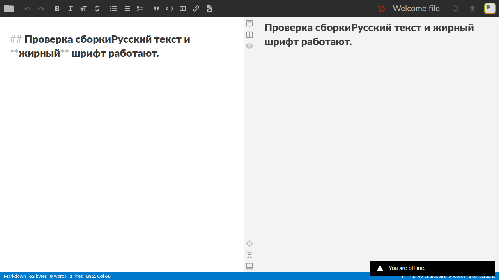

# Установка на ПК

> Не хотите ничего собирать? Возьмите готовый архив из релиза и запустите `python3 -m http.server`
> или готовый docker-образ — [quickstart.md](quickstart.md). Сборка ниже нужна только если вы хотите
> свой `dist/` или правки в коде.

Два независимых шага, которые часто путают:

1. **Сервер** — отдаёт файлы сборки. Без него открывать нечего (открыть `dist/index.html` двойным
   щелчком из проводника нельзя: приложение грузит модули и Service Worker по HTTP).
2. **Установка как приложение** — браузер создаёт ярлык и отдельное окно без адресной строки (PWA).
   Магазин приложений для этого не нужен.

## Шаг 1. Локальный сервер

```bash
cd ~/stackedit
.toolchain/node-v14.21.3-linux-x64/bin/node .        # или просто: node . (если Node 14 в PATH)
```

```
HTTP server started: http://localhost:8080
```

Открыть <http://localhost:8080/app>. Порт меняется переменной `PORT`:

```bash
PORT=9000 node .
```

Сервер нужен только чтобы раздать статику. Никаких данных наружу он не отправляет; файлы остаются в
браузере.

### Автозапуск (Linux, systemd --user)

`~/.config/systemd/user/stackedit.service`:

```ini
[Unit]
Description=StackEdit (локальный сервер)
After=network.target

[Service]
Type=simple
WorkingDirectory=/home/USER/stackedit
Environment=PORT=8080
ExecStart=/home/USER/stackedit/.toolchain/node-v14.21.3-linux-x64/bin/node .
Restart=on-failure

[Install]
WantedBy=default.target
```

```bash
systemctl --user daemon-reload
systemctl --user enable --now stackedit
systemctl --user status stackedit
loginctl enable-linger "$USER"    # чтобы сервис поднимался после перезагрузки без входа в сессию
```

Путь в `ExecStart` и `WorkingDirectory` подставьте свои (замените `USER`). Юнит — стандартный шаблон;
в среде, где готовилась эта документация, `systemctl --user` был недоступен (нет user-bus в контейнере),
поэтому автозапуск не проверялся — после включения посмотрите `systemctl --user status stackedit`.

### Автозапуск (Windows)

Сборку удобнее держать в WSL, но раздавать статику можно и нативным Node:

```powershell
# один раз: собрать dist на Linux/в WSL, затем из Windows
setx PORT 8080
node .
```
Автозапуск — «Планировщик заданий» → «Создать задачу» → триггер «При входе в систему» → действие
`node.exe` с аргументом `.` и рабочей папкой проекта. Либо `nssm install StackEdit node .`.

### Автозапуск (macOS)

`~/Library/LaunchAgents/io.stackedit.plist` с `ProgramArguments` = `[node, .]`, `WorkingDirectory` =
путь к проекту, затем `launchctl load ~/Library/LaunchAgents/io.stackedit.plist`.

## Шаг 2. Установка как приложение (PWA)

Условие: страница открыта по `http://localhost` или по `https://`. `localhost` браузеры считают
защищённым контекстом, поэтому сертификат для локального варианта не нужен.

**Chrome / Chromium / Яндекс Браузер**

1. Открыть <http://localhost:8080/app>.
2. В адресной строке появляется значок «Установить» (монитор со стрелкой), либо меню ⋮ →
   «Сохранить и поделиться» → «Установить приложение…» / «Установить StackEdit».
3. Подтвердить. Появится отдельное окно и ярлык в меню приложений.

**Edge**: меню «…» → «Приложения» → «Установить этот сайт как приложение».

**Firefox**: установки PWA нет, только вкладка с сайтом (это ограничение Firefox, не сборки).

Что это даёт: отдельное окно без адресной строки, свой значок в доке/меню, работа без сети после
первого запуска. Данные — те же, что у вкладки: один и тот же профиль браузера, один и тот же набор
файлов в IndexedDB.

Если значка установки нет:

- откройте DevTools → Application → Manifest: манифест должен подгружаться без ошибок;
- Application → Service Workers: `sw.js` должен быть `activated and running`;
- страница должна быть `localhost`/`https`, а не `http://192.168.x.x`;
- если ранее нажимали «не сейчас» — меню ⋮ → «Установить приложение» остаётся доступным.

Удаление: правый клик по ярлыку → «Удалить» / в настройках браузера «Приложения». Данные в браузере
при этом остаются.

## Офлайн и обновления

Service Worker кеширует бандлы и иконки при первой загрузке — дальше приложение стартует без сети
(проверено: после отключения сети страница открывается и редактирование работает).

Когда вы пересоберёте `dist/` (`npm run build`), при следующем открытии приложение подхватит новую
версию, покажет уведомление «StackEdit has just updated itself!» и перезагрузится. Если висит старая
версия — DevTools → Application → Service Workers → «Update», либо `Ctrl+Shift+R` и повторная загрузка.



## Где лежат ваши файлы

- Файлы и папки — IndexedDB браузера; настройки и активная вкладка — localStorage.
- Другое устройство, другой браузер, другой профиль — **другой** набор файлов. Автосинхронизации нет.
- Очистка «данных сайтов» в браузере, режим инкогнито, смена профиля = потеря локальных файлов.
  Делайте экспорт: `Ctrl+S` → Export to disk / Import from disk, или настройте Git-провайдера.
- Перенос на другое устройство: экспортировать `.md` (или HTML-архив) и импортировать там.

## Если порт занят

```
Error: listen EADDRINUSE: address already in use :::8080
```

```bash
ss -ltnp | grep 8080      # кто держит порт
PORT=8081 node .          # или просто другой порт
```

## Проверка «всё ли на месте» одной командой

```bash
curl -s -o /dev/null -w 'app:%{http_code}\n' http://localhost:8080/app
curl -s http://localhost:8080/conf; echo
curl -s -o /dev/null -w 'sw:%{http_code} manifest:%{http_code}\n' \
  http://localhost:8080/sw.js http://localhost:8080/manifest.c9128ce574e7548a3b0d3bcd8bfa212c.json
```
