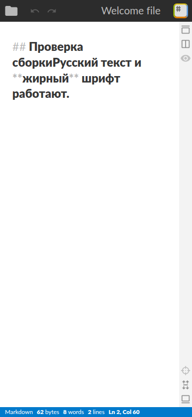

# Установка на телефон (без магазина приложений)

## Почему магазин не нужен

У StackEdit **нет нативного приложения** — ни в Google Play, ни в App Store. Это веб-приложение (PWA),
которое браузер ставит на домашний экран как обычную программу: свой значок, отдельное окно без
адресной строки, работа офлайн после первого запуска.

Отсюда простой вывод: недоступность Google Play в России на StackEdit никак не влияет. Проблема —
не магазин, а **адрес, по которому открывается приложение**: браузер разрешает установку только для
`https://` (исключение — `localhost`). Поэтому телефону нужен свой HTTPS-адрес со сборкой.

Что не является рабочим путём:

- сторонние приложения «StackEdit» в Play/App Store — это не этот проект;
- папка `chrome-app/` в репозитории — устаревший формат Chrome-приложений (manifest v2), современный
  Chrome его не запускает;
- открыть `dist/index.html` из файлового менеджера — приложение не заработает, нужен HTTP.

## Что понадобится

1. Собранный `dist/` (см. [build.md](build.md)) — либо локально, либо сразу на сервере.
2. HTTPS-адрес с валидным сертификатом (не самоподписанным: с ним браузер не даёт устанавливать PWA).
   Варианты — в [self-host.md](self-host.md): VPS + Caddy, домашний сервер + туннель.
3. Chrome на Android или Safari на iOS. На Android также работает Edge, Яндекс Браузер, Samsung Internet.

## Способ 1 — PWA из своего HTTPS-адреса (рекомендуется)

Это тот самый «другой рабочий способ»: ни магазин, ни аккаунт Google не участвуют.

### Android (Chrome)

1. Откройте `https://ваш-домен/app` в Chrome.
2. Дождитесь полной загрузки редактора (Service Worker встаёт на первое открытие).
3. Меню ⋮ → **«Установить приложение»** (в некоторых версиях — «Добавить на главный экран»).
   Если пункта нет — ⋮ → «Сохранить и поделиться» → «Установить приложение».
4. Подтвердите. На рабочем столе появится значок StackEdit; приложение откроется в отдельном окне.
5. Проверка офлайна: отключите мобильный интернет и Wi-Fi, запустите приложение с домашнего экрана —
   оно должно открыться и дать редактировать файлы.

Приложение само предложит установку при первом визите (в коде есть обработчик `beforeinstallprompt`),
но Chrome показывает это один раз — если отказались, ставьте через меню.

### iOS / iPadOS (Safari)

1. Откройте `https://ваш-домен/app` **в Safari** (в Chrome на iOS установки PWA нет).
2. Кнопка «Поделиться» → **«На экран „Домой“»** → «Добавить».
3. Запуск — с иконки; открывается в полноэкранном режиме. Офлайн работает так же (Service Worker).

Ограничение iOS: у таких приложений отдельное хранилище от Safari-вкладок; при удалении иконки
локальные данные удаляются. Экспортируйте файлы (`Ctrl+S`-эквивалент — меню ☰ → Import/Export)
или настройте Git-провайдера.

## Способ 2 — быстрый, без установки: локальная сеть

Если сервер уже запущен на компьютере (см. [pc.md](pc.md)) и телефон в той же Wi-Fi:

```bash
# на компьютере
PORT=8080 node .
hostname -I        # например 192.168.1.42
```

На телефоне: `http://192.168.1.42:8080/app`.

Работает как обычный сайт: редактор, файлы, предпросмотр. **Не работает**: установка на домашний
экран и офлайн-кеш (нет защищённого контекста), и адрес меняется при смене сети. Хорошо для разовой
правки, плохо как постоянное решение.

## Способ 3 — если нужен именно APK

PWA можно упаковать в APK (Trusted Web Activity). Магазин для этого не нужен, APK ставится
«из неизвестного источника».

Инструменты: [Bubblewrap](https://github.com/GoogleChromeLabs/bubblewrap) (CLI, официальный) или
[PWABuilder](https://www.pwabuilder.com/) (веб-форма, генерирует пакет).

Порядок для Bubblewrap:

```bash
npm i -g @bubblewrap/cli
bubblewrap init --manifest https://ваш-домен/manifest.c9128ce574e7548a3b0d3bcd8bfa212c.json
bubblewrap build           # app-release-signed.apk
```

Что нужно знать до того, как браться:

- TWA — это обёртка над вашим же HTTPS-адресом: без работающего сервера APK бесполезен, офлайн даёт
  ровно то, что даёт Service Worker;
- понадобится JDK и Android SDK (Bubblewrap предложит скачать, это ~1–2 ГБ);
- для TWA нужно подтверждение владения доменом (файл `/.well-known/assetlinks.json` на сервере) —
  иначе вместо приложения откроется браузер с адресной строкой;
- для нормальной работы нужен key store и подпись; при обновлении — тот же ключ;
- в этой сборке APK не проверялся: на машине, где готовилась документация, нет Android SDK.
  Способ 1 (установка PWA из Chrome) даёт тот же результат без этих шагов.

## Что на телефоне работает, а что нет

| Возможность | Телефон |
| --- | --- |
| Редактор, предпросмотр, подсветка, KaTeX/Mermaid | ✅ |
| Локальные файлы и папки | ✅ (IndexedDB браузера) |
| Офлайн (после первой загрузки по HTTPS) | ✅ |
| Установка на домашний экран, отдельное окно | ✅ (Chrome/Edge на Android, Safari на iOS) |
| Экспорт в PDF / Pandoc (docx, epub) | ❌ требует серверного бэкенда stackedit.io |
| Синхронизация с GitHub/GitLab/Drive/Dropbox | ⚠️ только со своими OAuth-ключами на своём сервере |
| Горячие клавиши | ❌ (нет физической клавиатуры; на Android с внешней клавиатурой работает) |

Файлы на телефоне живут в браузере. Чтобы не потерять — экспорт в файл или Git-провайдер; перенос
между устройствами вручную через экспорт/импорт.

## Если установка не предлагается

| Симптом | Причина и что делать |
| --- | --- |
| Нет пункта «Установить приложение» | Открыто по `http://` (не `localhost`) или по самоподписанному сертификату — нужен валидный HTTPS |
| Пункт был, пропал | Chrome уже спрашивал и получили отказ; меню ⋮ → «Установить приложение» остаётся; либо очистите данные сайта и обновите |
| Приложение открылось, но пустое/белое | Не загрузились бандлы: проверьте, что сервер отдаёт `/static/js/*` и `/manifest.*.json` без 404 |
| Открывается с адресной строкой | Это вкладка, а не установленное приложение: повторите установку из меню |
| Офлайна нет | Первая загрузка была неполной или Service Worker не активировался: DevTools по USB → Application → Service Workers |
| «Небезопасное соединение» на своём домене | Сертификат Let's Encrypt не выпущен/истёк, либо домен не указывает на сервер |


