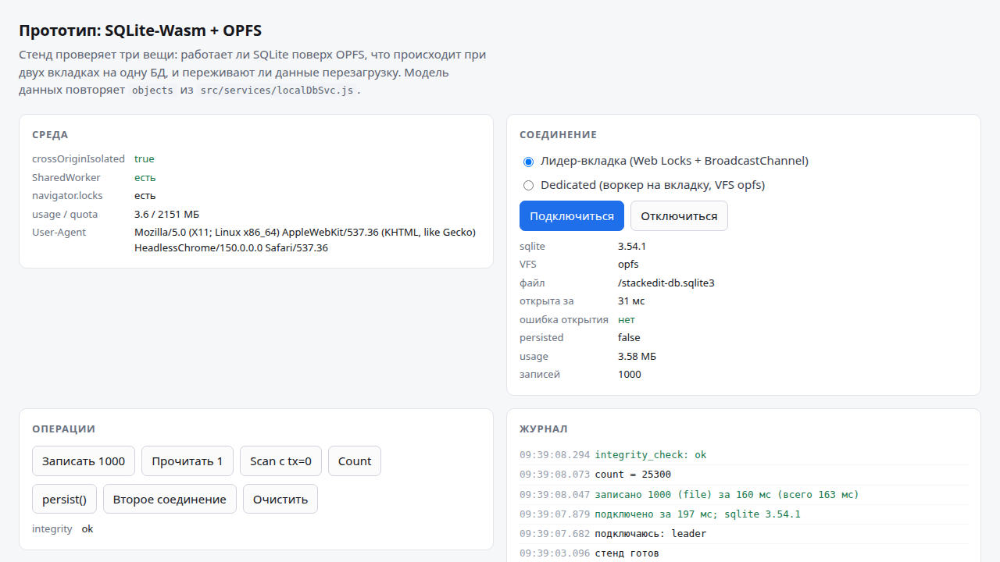

# Прототип: SQLite-Wasm + OPFS как замена IndexedDB в StackEdit

Проверяет, годится ли SQLite поверх OPFS для локальной БД StackEdit — и при каких условиях.
Ничего в основном приложении не меняется: это отдельный стенд, который запускается своим сервером.

Вывод коротко: **как «просто заменить IndexedDB» — нет**; как второй бэкенд под SQL-запросы — да, но
только с одним владельцем БД на origin (вкладка-лидер), а не «воркер на вкладку».



## Запуск

```bash
node prototype/sqlite-opfs/fetch-vendor.mjs     # один раз: скачать sqlite-wasm (~1.5 МБ, vendor не в git)
node prototype/sqlite-opfs/server.mjs           # http://localhost:8791/
```

Сервер нужен свой, потому что VFS `opfs` требует cross-origin isolation: `python -m http.server`
заголовки `Cross-Origin-Opener-Policy` / `Cross-Origin-Embedder-Policy` не отдаёт.

Стенд: `http://localhost:8791/`. В браузере видно окружение (`crossOriginIsolated`, наличие
`SharedWorker`, `navigator.locks`), подключение, операции и журнал.

## Что внутри

| Файл | Роль |
| :--- | :--- |
| `public/db-core.js` | SQLite-Wasm, схема `objects` (id, type, hash, tx, json) — как в `src/services/localDbSvc.js` |
| `public/db.dedicated.js` | Dedicated Worker, открывает БД и отвечает на сообщения |
| `public/db-leader.js` | Вкладка-лидер: Web Locks выбирают владельца, запросы идут через BroadcastChannel |
| `public/db-client.js` | Клиент для режима «воркер на вкладку» (для сравнения) |
| `public/db.shared.js` | **Контрпример**: попытка держать БД в SharedWorker. Не работает, см. ниже |
| `public/vendor/sqlite-wasm/` | `@sqlite.org/sqlite-wasm` 3.54.1 (`index.mjs`, `sqlite3.wasm`) |
| `server.mjs` | Статический сервер с COOP/COEP |

Модель данных повторяет текущую: `id` — ключ, `hash` — содержимое, `tx` — номер транзакции,
`hash = null` — delete-маркер, индекс по `tx` — «что изменилось с версии N».

## Результаты проверки

Chrome 150 (headless), Linux, COOP/COEP включены, SQLite-Wasm 3.54.1.

### 1. SQLite поверх OPFS работает

| Что | Результат |
| :--- | :--- |
| Открытие БД (VFS `opfs`, Dedicated Worker) | 31–77 мс |
| Запись 1000 строк одной транзакцией | 113–162 мс |
| Чтение по ключу | мгновенно |
| `scan` по индексу `tx` (1000 строк) | единицы мс |
| `PRAGMA integrity_check` после нагрузочных прогонов | `ok` |
| Второе соединение к тому же файлу внутри воркера | открывается |

Размер БД после ~23 000 строк: ~190–220 КБ (`navigator.storage.estimate().usage`).

### 2. `navigator.storage.persist()` в воркере отсутствует

В Dedicated Worker `navigator.storage.persist` — `undefined` (в окне есть). Значит разрешение
запрашивает страница, а воркер только сообщает `persisted()`/`estimate()`.
В headless `persist()` всегда вернул `granted: false` — это ограничение среды, не вывод о браузере
пользователя.

### 3. SharedWorker не может владеть OPFS-БД

Проверено прямыми пробами в `SharedWorker`:

| Проверка | Результат в SharedWorker |
| :--- | :--- |
| `self.crossOriginIsolated` | `false` (хотя страница изолирована) |
| `SharedArrayBuffer` | `undefined` |
| `navigator.storage.getDirectory` | есть |
| `FileSystemFileHandle.createSyncAccessHandle()` | падает: `SecurityError` («... unsafe for access ...») |
| `sqlite3.oo1.OpfsDb` | `undefined` (VFS `opfs` не поднимается) |
| `installOpfsSAHPoolVfs` | есть, но `opfs-sahpool` без sync-access-handle тоже не работает |

Плюс две ловушки, на которых стенд реально завис:

- **top-level await в module SharedWorker** — `onconnect` не вызывается вообще, воркер молча висит;
- **статический `import` модуля, тянущего `sqlite3.wasm`** — то же самое: тело модуля не доходит до
  назначения `onconnect`.

Поэтому `db.shared.js` в прототипе оставлен как контрпример, а рабочая схема — вкладка-лидер.

### 4. «Воркер на вкладку»: две вкладки на один файл

Вопреки ожиданию («вторая вкладка получит ошибку блокировки»), в Chrome 150 два Dedicated Worker
из разных вкладок **открыли один и тот же файл** OPFS и писали в него параллельно:

| Прогон | Результат |
| :--- | :--- |
| Две вкладки, по 500 уникальных строк | 1000 строк, `integrity_check` = `ok` |
| Две вкладки, непрерывная запись ~4 с | 23 300 строк, потерь нет, `integrity_check` = `ok` |
| Один из ранних прогонов | вкладка перестала отвечать: `count` не вернулся за 10 с (busy/зависание) |

То есть поведение **недетерминированное**: иногда всё проходит, иногда воркер залипает на блокировке.
Документация sqlite.org описывает конкурентность через `SQLITE_BUSY` и ретраи, но гарантий для двух
независимых процессов на одном OPFS-файле не даёт. Для пользовательских документов это неприемлемый
класс отказа: не ошибка, а тихое зависание или потеря.

### 5. Вкладка-лидер: рабочая схема

Один владелец БД на origin: Web Locks (`stackedit-db-leader`) выбирают вкладку, она держит
Dedicated Worker с БД, остальные вкладки шлют запросы через BroadcastChannel с адресными ответами.

| Проверка | Результат |
| :--- | :--- |
| Подключение второй вкладки как клиента | 16 мс |
| Параллельная запись из двух вкладок ~5 с | 20 100 строк: 18 300 от лидера + 1 800 от клиента, `integrity_check` = `ok` |
| Закрытие вкладки-лидера | вторая вкладка стала лидером за 194 мс, БД открылась за 39 мс, данные на месте |
| Ошибки/таймауты в этих прогонах | нет |

Цена схемы: задержка на BroadcastChannel (запись 100 строк через клиента — 54–89 мс против 40–47 мс
у лидера) и необходимость переподключения при смене лидера.

## Что это значит для StackEdit

1. `localDbSvc.js` менять «в лоб» нельзя: его модель — нативный IndexedDB, который сам разбирается с
   несколькими вкладками. SQLite+OPFS требует явного владельца, то есть новой архитектуры
   (лидер + шина), а не замены вызова `indexedDB.open` на `OpfsDb`.
2. Если делать — то как отдельный сервис (`sqliteDbSvc`) с лидер-выбором, а IndexedDB оставить
   основным путём до появления реальной задачи, где нужен SQL (история версий, поиск по документам).
3. `persist()` вызывать из окна, не из воркера; и помнить, что вытеснение origin'а всё равно
   возможно (см. `docs/ru/chrome-as-server.md`, § 3).
4. SharedWorker как «сервер БД» не вариант: OPFS там недоступен. Это же ограничение стоит учитывать
   в любых планах «один воркер на все вкладки».

## Проверки, которые стоит повторить перед внедрением

- на реальном устройстве (Windows/Android), а не в headless: `persist()`, вытеснение, квоты;
- две вкладки на один workspace с реальными паттернами записи `localDbSvc` (интервал 1 с, батчи);
- поведение при обновлении версии приложения (схема, миграции);
- Safari/iOS: OPFS-квоты и лимиты памяти вкладки.
